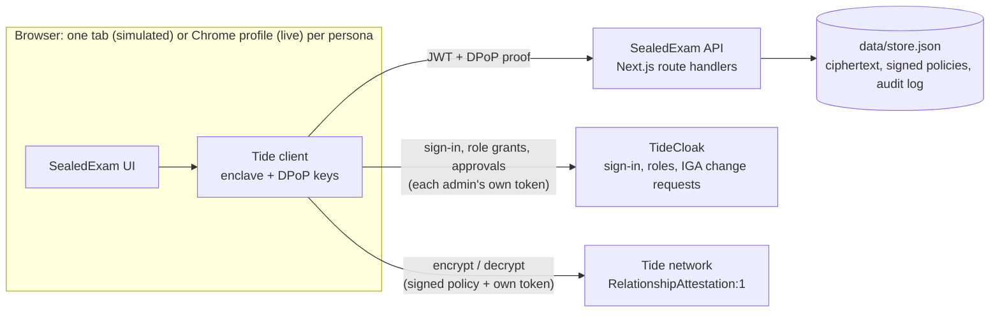
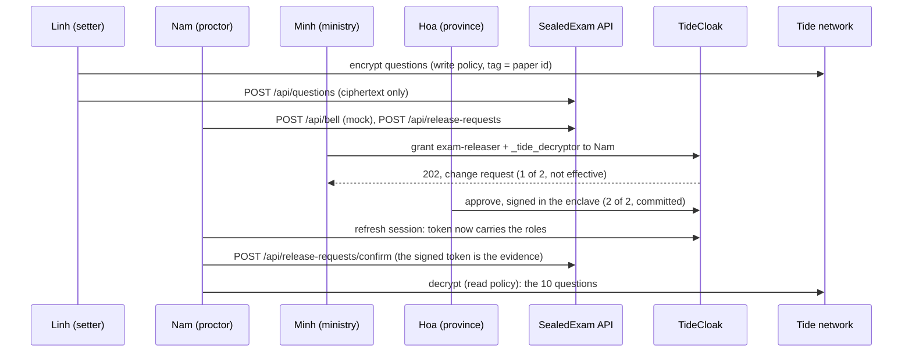

[](https://tide.org/tidecloak?utm_source=github&utm_medium=readme&utm_campaign=unlocked)

*Tiếng Việt: [docs/README.vi.md](docs/README.vi.md)* · **Demo video: [demo/sealedexam-demo.mp4](demo/sealedexam-demo.mp4)**

## Project overview

SealedExam delivers national exam papers to exam sites days early, encrypted so that nobody, not even the ministry or the platform, can open one alone before the bell.

Built with [TideCloak](https://tide.org/tidecloak?utm_source=github&utm_medium=readme&utm_campaign=unlocked).

### 1. Vision & originality
A digital chain of custody for high-stakes national exams. Papers travel early as ciphertext; the authority to open one only emerges at exam time, when independent council members approve. No official, admin or vendor holds it alone.

### 2. Trust constraint insight
Exam security relies on a costly chain of trusted people: quarantined setters, police escorts, sealed envelopes. Going digital only moves the master key to a database admin or cloud vendor, so computer-based national exams stay hard to trust. Without a master key, papers can travel digitally, early, at national scale.

### 3. Value & impact
Around one million candidates sit Vietnam's national graduation exam each year. SealedExam cuts the cost of physical custody, protects honest staff from suspicion and makes computer-based exams credible. In-room cheating still needs room controls.

### 4. Why TideCloak matters
Questions are encrypted in the setter's browser; the Tide network releases decryption only to the exam-releaser role, so our server never can. Setters can seal but never reopen. Granting that role is a TideCloak change request that needs two of three council signatures. With ordinary login, whoever controls the database could open the paper.

### 5. Prototype & storytelling
Tide's licensing service failed on our realm, so, as the organisers advised, the demo simulates TideCloak's sign-in, quorum and network checks behind the same interfaces. The app's token, DPoP and role checks are real (54 tests). Watch for: the operator finds no plaintext; an official's self-grant stays at "1 of 2" and decryption is refused; two council signatures let the proctor open the paper.

---

## Architecture



**The property that matters:** there is no arrow from the API to the Tide network. The app server stores and serves ciphertext, but it has no credential the network would decrypt for, and no key of its own. It verifies tokens locally against the realm's public key.

### Two modes
| | Simulated (default, used in the video) | Live |
|---|---|---|
| Sign-in | Persona picker at `/sim-tide/login`; the token is still DPoP-bound to a key made in the tab | Tide passwordless login |
| Role grants and quorum | `/sim-tide/admin/...`: same IGA endpoints and shapes; threshold `max(1, floor(0.7 × admins))` = 2 of 3 | TideCloak IGA, signed in the Tide enclave |
| Encrypt / decrypt | `/sim-tide/network/...`: runs the `RelationshipAttestation:1` checks on the caller's own token | Tide ORK network |
| Enclave prompt | In-page modal; nothing is signed without **Sign** | Tide popup |
| App API, token + DPoP + role checks | Unchanged | Unchanged |

The simulator lives only under [`src/lib/sim-tide/`](src/lib/sim-tide) and [`src/app/sim-tide/`](src/app/sim-tide), with its own state file (`data/sim-tide.json`). No `/api` route imports it. Switch with `NEXT_PUBLIC_TIDE_MODE=live`.

### Roles and the two paper policies
| Persona (fictional) | Before the bell | After quorum |
|---|---|---|
| Linh, question setter | `exam-setter`, `_tide_encryptor` | |
| Minh (ministry), Hoa (province), Tuấn (exam site) | `tide-realm-admin` (the council) | |
| Nam, proctor | `proctor` | + `exam-releaser`, `_tide_decryptor` |
| Quang, IT operator | `it-operator` | |

The paper `paper-math-2026` carries two network-signed policies (contract `RelationshipAttestation:1`, every item tagged with the paper id only):
- **Write:** role `exam-setter`, `["_tide_encryptor"]`. Setters can seal but not read, not even their own questions.
- **Read:** role `exam-releaser`, `["_tide_decryptor"]`. Nobody holds `_tide_decryptor` before the bell, so a policy alone opens nothing without a quorum grant.

### Release flow


The rogue-official case uses the same path: Minh files a grant for himself. Filing counts as one approval, so it stays at **1 of 2**, and the network keeps refusing to decrypt.

### Who can do what
| Attack | Ordinary login + backend permissions | SealedExam |
|---|---|---|
| DB or cloud admin reads the question bank | Reads every paper | Sees ciphertext only |
| Official grants themselves release rights | Edits one row | A pending change request at 1 of 2; decryption refused |
| App server is compromised | Paper and key both leak | No key on the server to take |
| Paper intercepted in transit | Depends on who holds the key | Useless without the role the network checks |

### Limitations
- **Simulation:** in simulated mode the realm key and the network key sit in `data/sim-tide.json` on the same machine as the app. That stands in for TideCloak and the Tide network; in the live system no such key exists in one place. Picking a persona replaces proving a Tide key.
- The 2-of-3 threshold is TideCloak's realm-wide rule for three admins, not a per-role setting.
- A full quorum can still collude. Every approval is attributable: each authorizer and time is recorded.
- Once opened at the bell, the paper can be photographed. In-room controls still apply.
- Approvals the app records are relayed by a council member's browser and labelled `client-reported`. The decisive evidence is the proctor's own signed token.
- The server could delete or swap ciphertext. It cannot read the paper, but it can break integrity and availability.
- Not verified on a live realm: whether the master-realm admin can bypass IGA ([`scripts/check-master-admin-bypass.sh`](scripts/check-master-admin-bypass.sh) answers it).

---

## Setup

### Prerequisites
- Node.js 20+ and npm
- Chrome or Edge (not the VS Code browser)
- Live mode only: Docker Desktop, `curl`, `jq`

### Quick start (simulated TideCloak)
```bash
npm install
npm run sim:init     # realm key, six personas, empty store
npm run dev          # http://localhost:3000
npm test             # 54 tests: auth, DPoP, roles, routes, release flow
```
Open one browser **tab per persona** with ⌘T / Ctrl+T (not "Duplicate tab", which copies the session) and sign in as that persona. To start over: `npm run sim:init`, restart `npm run dev`, and sign in again in every tab.

### Demo walkthrough
1. **Minh**, Council: sign the write and the read policy (once, before exam day).
2. **Linh**, Seal questions: seal the ten synthetic maths questions, then **Try to reopen**: refused.
3. **Quang**, Operator view: **Reload**, search for `derivative`: 0 matches, ciphertext only.
4. **Minh**, Council: **Grant myself release rights**: pending, 1 of 2. **Try to decrypt now**: refused.
5. **Nam**, Exam room: **Ring the bell (mock)**, then **Request release**.
6. **Minh**: **File role grant**. **Hoa**: **Approve** the card for Nam and **Sign**: quorum met.
7. **Nam**: **Refresh session**, then **Open paper**.
8. **Minh**: Audit trail, including who signed each role change.

### Live TideCloak (optional)
```bash
cp .env.example .env   # KC_BOOTSTRAP_ADMIN_PASSWORD, TIDE_LICENSE_EMAIL, TIDE_TERMS_ACCEPTED=yes
npm run init           # TideCloak on :8080, realm, personas, invite links, exports data/tidecloak.json
NEXT_PUBLIC_TIDE_MODE=live npm run dev
```
Open each invite link in that persona's own Chrome profile and allow pop-ups for `localhost:3000` and `localhost:8080`. Only the person who owns the licence email may set `TIDE_TERMS_ACCEPTED=yes`, after reading https://tide.org/legal. Windows notes: [docs/setup-windows.vi.md](docs/setup-windows.vi.md).

### Project layout
```
src/app/            pages: setter, operator, room, council, audit
src/app/api/        app API; every route verifies JWT + DPoP + role on the server
src/app/sim-tide/   simulated TideCloak: sign-in, IGA admin API, network
src/lib/auth/       token and DPoP verification, role checks
src/lib/tide/       browser helpers: seal/open, IGA approvals, live/simulated switch
src/lib/sim-tide/   simulator state and contract checks
src/lib/store.ts    data/store.json: ciphertext, policies, audit (no keys, no plaintext)
scripts/            sim-init, live realm bootstrap, demo reset, master-admin bypass check
test/               vitest suites
docs/               Vietnamese README, Windows setup, original build brief
demo/               demo video
```

### API
| Route | Allowed caller |
|---|---|
| `POST /api/questions` | `exam-setter` |
| `GET /api/vault` | `it-operator` or council |
| `GET /api/paper` | any signed-in user |
| `POST /api/policies` | council |
| `POST /api/bell` (mock) | `proctor` |
| `GET /api/release-requests` | any signed-in user |
| `POST /api/release-requests` | `proctor`, only after the bell |
| `PATCH /api/release-requests` | council (links a change request) |
| `POST /api/release-requests/confirm` | `proctor` whose token carries `exam-releaser` + `_tide_decryptor` |
| `GET /api/audit`, `POST /api/audit` | any signed-in user (browser events are labelled `client-reported`) |

Tokens are DPoP-bound: a plain `fetch` with a Bearer token is rejected.

### Troubleshooting
| Symptom | Fix |
|---|---|
| "Simulated TideCloak is not initialised" | Run `npm run sim:init`, then restart `npm run dev`. |
| 401 on every call after `sim:init` | The realm key changed: sign out and sign in again in each tab. |
| A new role does not show up | Click **Refresh session**. |
| Live: `setUpTideRealm failed (HTTP 500)` | Tide's licensing service did not answer (`docker logs tidecloak \| grep Midgard`). Re-run `npm run init` later. |

All people, exam sites and questions in this repository are fictional.
