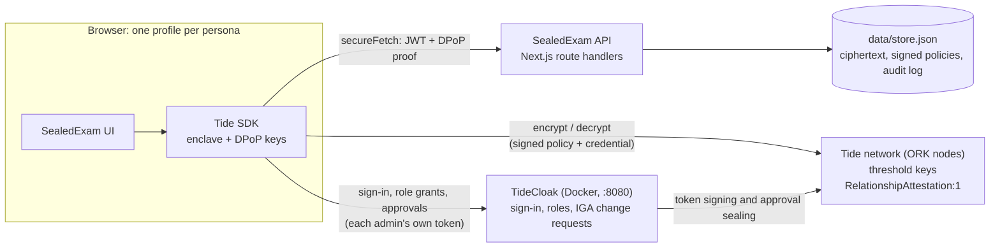
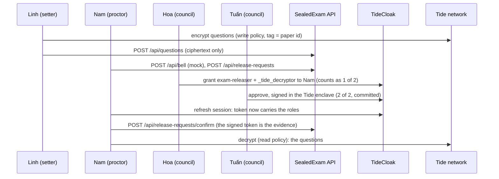

[](https://tide.org/tidecloak?utm_source=github&utm_medium=readme&utm_campaign=unlocked)

## Project overview

SealedExam delivers national exam papers to exam sites days early, encrypted so that nobody, not even the ministry or the platform, can open one alone before the bell.

Built with [TideCloak](https://tide.org/tidecloak?utm_source=github&utm_medium=readme&utm_campaign=unlocked).

### 1. Vision & originality
A digital chain of custody for high-stakes national exams. Papers travel early as ciphertext; the authority to open one only emerges at exam time, when independent council members approve. No official, admin or vendor holds it alone.

### 2. Trust constraint insight
Exam security relies on a costly chain of trusted people: quarantined setters, police escorts, sealed envelopes. Going digital only moves the master key to a database admin or cloud vendor, so computer-based national exams stay hard to trust. Without a master key, papers can travel digitally and early.

### 3. Value & impact
Around one million candidates sit Vietnam's national graduation exam each year. SealedExam cuts the cost of physical custody, protects honest staff from suspicion and makes computer-based exams credible. In-room cheating still needs room controls.

### 4. Why TideCloak matters
Questions are encrypted in the setter's browser; the Tide network releases decryption only to the exam-releaser role, so our server never can. Setters can seal but never reopen. Granting that role is a TideCloak change request that council members must sign; with our three-member council that is two of three. With ordinary login, whoever controls the database could open the paper.

### 5. Prototype & storytelling
Look for: the operator sees only ciphertext; an official's self-grant stays at "1 of 2", decryption refused; at the bell, two council signatures let the proctor open the paper, all on the audit trail. Tide's licensing service failed on our realm, so this build simulates TideCloak sign-in, roles, quorum and network checks; our server checks are unchanged and tested end to end.

---

## Demo walkthrough

Sign in as each fictional persona in its own browser profile (or tab, in simulated mode):

1. **Minh (council), once before exam day:** sign the two paper policies.
2. **Linh (setter):** seal the sample paper. Try to reopen it: refused.
3. **Quang (IT operator):** open the vault. Ciphertext only; opening the paper is refused.
4. **Minh:** grant himself release rights. The change request stays at 1 of 2 and decryption is refused.
5. **Nam (proctor):** ring the bell (mock) and request release.
6. **Hoa, then Tuấn (council):** approve Nam's grant. At 2 of 2 it commits.
7. **Nam:** refresh the session, confirm the grant and open the paper.
8. **Anyone:** read the audit trail.

---

## Architecture



**The property that matters:** there is no arrow from the API to the Tide network. The app server stores and serves ciphertext but holds no key and no credential the network would decrypt for. It verifies tokens locally against the realm's embedded key.

| Component | Where | Role |
|---|---|---|
| API | [`src/app/api/`](src/app/api) | Every route verifies the JWT, the DPoP proof and the caller's role on the server |
| Auth | [`src/lib/auth/`](src/lib/auth) | Token and DPoP verification; app roles are realm roles, the council is `tide-realm-admin` on `realm-management` only |
| Store | [`src/lib/store.ts`](src/lib/store.ts) | A JSON file, so anyone can `cat data/store.json` and see there is no plaintext or key in it |
| Tide helpers | [`src/lib/tide/`](src/lib/tide) | Seal and open through `RelationshipAttestation:1`; file and approve role grants (two-phase enclave approval) |
| Simulated TideCloak | [`src/app/sim-tide/`](src/app/sim-tide), [`src/lib/sim-tide/`](src/lib/sim-tide) | Same endpoints and shapes as TideCloak and the Tide network; separate state, never imported by `/api` |
| Realm bootstrap | [`scripts/init-tidecloak.sh`](scripts/init-tidecloak.sh) | Live mode: starts TideCloak, licenses the realm, enables IGA, creates roles and personas, makes the council |

### Roles and the two paper policies
| Persona (fictional) | Before the bell | After quorum |
|---|---|---|
| Linh, question setter | `exam-setter`, `_tide_encryptor` | |
| Minh (ministry), Hoa (province), Tuấn (exam site) | `tide-realm-admin` (the council) | |
| Nam, proctor | `proctor` | + `exam-releaser`, `_tide_decryptor` |
| Quang, IT operator | `it-operator` | |

The paper carries two network-signed policies (built-in contract `RelationshipAttestation:1`, every item tagged with the paper id only):
- **Write:** role `exam-setter`, `_tide_encryptor`. Setters can seal but not read, not even their own questions.
- **Read:** role `exam-releaser`, `_tide_decryptor`. Nobody holds `_tide_decryptor` before the bell, so a policy alone opens nothing without a quorum grant.

### Release flow


A rogue official uses the same path: Minh files a grant for himself. TideCloak counts each approver once, so it stays at **1 of 2** and the network keeps refusing to decrypt.

### Who can do what
| Attack | Ordinary login + backend permissions | SealedExam |
|---|---|---|
| DB or cloud admin reads the question bank | Reads every paper | Sees ciphertext only |
| Official grants themselves release rights | Edits one row | Pending change request at 1 of 2; decryption refused |
| App server is compromised | Paper and key both leak | No key on the server to take |
| Paper intercepted in transit | Depends on who holds the key | Useless without the role the network checks |

### Built-in, custom, simulated, mocked
- **Built-in (TideCloak and Tide):** sign-in, roles, browser encryption with role-based decryption, IGA change requests with quorum approval in the enclave, enforcement by the Tide network.
- **Custom (this repo):** the API and its role checks, release-request workflow, audit trail, operator view, realm bootstrap.
- **Simulated in this build:** TideCloak sign-in, role grants with the quorum rule, the enclave pop-up and the network's contract checks (`/sim-tide`). Set `NEXT_PUBLIC_TIDE_MODE=live` to use a real realm.
- **Mocked:** the exam bell (a button, not a time-lock), distribution to exam sites, and all people, sites and questions.

### Limitations
- The 2-of-3 threshold is TideCloak's rule `max(1, floor(0.7 × admins))` with three council admins. It is not a per-role setting and applies to every governed change in the realm. It is demonstrated in the simulator, not yet on a live realm.
- A full quorum can still collude. Every approval is attributable: each authorizer and time is recorded.
- Once opened at the bell, the paper can be photographed. In-room controls still apply.
- The server cannot read TideCloak's change requests itself (it holds no admin credential). Approvals it records are relayed by a council member's browser and labelled `client-reported`. The decisive evidence is the proctor's own signed token.
- The server could delete or swap ciphertext. It cannot read the paper, but it can break integrity and availability.

---

## Setup

### Quick start: simulated TideCloak (default)
Needs Node.js 20+ and npm. No Docker, no Tide licence.

```bash
npm install
npm run sim:init     # new simulated realm + six personas; clears demo data
npm run dev          # http://localhost:3000 → "Sign in with Tide" → pick a persona
```

Each browser tab holds one persona. Run `npm run sim:init` again to reset the demo.

### Tests
```bash
npm test             # 54 unit tests: auth, DPoP, roles, routes, release flow
npm run e2e:sim      # with `npm run dev` running: the whole demo story (F1–F9) over HTTP,
                     # including every refusal. Run `npm run sim:init` before each run.
npx tsc --noEmit     # type check
```

### Live TideCloak (optional)
Prerequisites: Docker Desktop running, `curl`, `jq` 1.7+, Chrome or Edge with one profile per persona (not the VS Code browser: it breaks Tide's enclave frame). On Windows, run the scripts in Git Bash.

1. `cp .env.example .env` and fill in:
   - `KC_BOOTSTRAP_ADMIN_PASSWORD`: a strong password for the local TideCloak master admin.
   - `TIDE_LICENSE_EMAIL`: a real address you control.
   - `TIDE_TERMS_ACCEPTED=yes`, only after you have read and agreed to https://tide.org/legal.
2. `npm run init`. It starts TideCloak on `localhost:8080`, creates the `sealedexam` realm and the six personas, and prints one invite link per persona (also in `data/invite-links.txt`, valid 12 hours). Open each link in **that persona's own browser profile** and create a Tide account; allow pop-ups and local-network access. When all six are linked it grants the council role and exports `data/tidecloak.json`. Re-running it resets the realm.
3. `NEXT_PUBLIC_TIDE_MODE=live npm run dev`, then sign in with Tide in each profile. A newly granted role appears after the persona refreshes their session.
4. Optional: `bash scripts/check-master-admin-bypass.sh` checks whether the master-realm admin can bypass IGA.

### API
| Route | Allowed caller |
|---|---|
| `POST /api/questions` | `exam-setter` |
| `GET /api/vault` | `it-operator` or council |
| `GET /api/paper` | any signed-in user |
| `POST /api/policies` | council |
| `POST /api/bell` (mock) | `proctor` |
| `GET /api/release-requests` | any signed-in user |
| `POST /api/release-requests` | `proctor`, only after the bell |
| `PATCH /api/release-requests` | council (links a TideCloak change request) |
| `POST /api/release-requests/confirm` | `proctor` whose token carries `exam-releaser` + `_tide_decryptor` |
| `GET /api/audit`, `POST /api/audit` | any signed-in user (browser events are labelled `client-reported`) |

Tokens are DPoP-bound: call the API with the SDK's `secureFetch`. A plain `fetch` with a Bearer token gets 401.

### Troubleshooting
| Symptom | Fix |
|---|---|
| `Simulated TideCloak is not initialised` | `npm run sim:init`, then restart `npm run dev`. |
| `setUpTideRealm failed`: `KEYGEN_FAILED` or `STRIPE_CHECKOUT_FAILED` | The real cause is in `docker logs tidecloak \| grep Midgard`. `InitializeWallet` timeouts or `FinalizeWallet` 503/500 ("Not enough orks returned an ok response") mean Tide's network did not answer. Wait and re-run `npm run init`; if it persists, ask Tide on Discord (https://discord.gg/XBMd9ny2q5) with that log. This blocked our live run on 22 Oct 2026. |
| `STOP: the Tide realm was NOT set up` | `.env` is missing `TIDE_LICENSE_EMAIL` or `TIDE_TERMS_ACCEPTED=yes`. |
| `Port 8080 is already in use` / TideCloak does not start | `docker rm -f tidecloak`, free port 8080, give Docker at least 4 GB RAM, re-run. |
| Sign-in or approval stalls with no error | Allow pop-ups and local-network access; use Chrome or Edge, not the VS Code browser. |
| A new role does not show up | Refresh the session or sign in again. |
| Stale session | DevTools → Application → Storage → Clear site data, then sign in again. |

---

## Contributing
- One branch per task (`feat/…`, `fix/…`, `docs/…`), merged into `main` through a reviewed pull request.
- Commit messages in English: `<type>: <imperative description>`, with `feat`, `fix`, `test`, `docs`, `refactor` or `chore`.
- Run `npm test` and `npx tsc --noEmit` before committing.
- Never commit `.env` or `data/` (local TideCloak database, adapter, invite links, store). Both are gitignored.
- Do not edit the Tide-provided files `public/tide_dpop_auth.html`, `public/silent-check-sso.html`, `src/app/providers.tsx` and `src/lib/auth/verifyDpop.ts`: changing them breaks sign-in.

All people, exam sites and questions in this repository are fictional.
