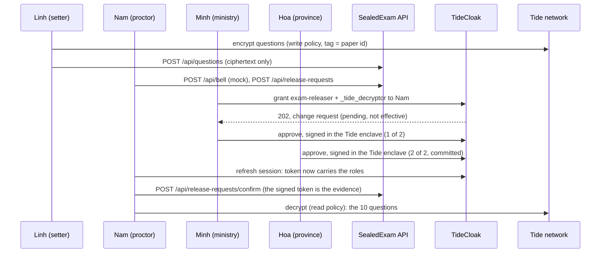

[](https://tide.org/tidecloak?utm_source=github&utm_medium=readme&utm_campaign=unlocked)

*Tiếng Việt: [README.vi.md](README.vi.md)*

## Project overview

SealedExam delivers national exam papers to exam sites days early, encrypted so that nobody, not even the ministry or the platform, can open one alone before the bell.

Built with [TideCloak](https://tide.org/tidecloak?utm_source=github&utm_medium=readme&utm_campaign=unlocked).

### 1. Vision & originality
A digital chain of custody for high-stakes national exams. Papers travel early as ciphertext; the authority to open one only emerges at exam time, when independent council members approve. No official, admin or vendor holds it alone.

### 2. Trust constraint insight
Exam security relies on a costly chain of trusted people: quarantined setters, police escorts, sealed envelopes. Going digital only moves the master key to a database admin or cloud vendor, so computer-based national exams stay hard to trust. Without a master key, papers can travel digitally, early, at national scale.

### 3. Value & impact
Around one million candidates sit Vietnam's national graduation exam each year. SealedExam cuts the cost of physical custody, protects honest staff from suspicion and makes computer-based exams credible. In-room cheating still needs room controls.

### 4. Why TideCloak matters
Questions are encrypted in the setter's browser; the Tide network releases decryption only to the exam-releaser role, so our server never can. Setters can seal but never reopen. Granting that role needs two of three council signatures in TideCloak's enclave. With ordinary login, whoever controls the database could open the paper.

### 5. Prototype & storytelling
Built: realm bootstrap (six fictional personas, three-member council), a ciphertext-only API with server-side token, DPoP and role checks (54 passing tests), and browser helpers for sealing, opening and quorum approval. Look for: the operator sees only ciphertext; an official's self-grant stays at "1 of 2"; two approvals let the proctor open the paper. Status: Tide's licensing service failed during the build, so the live run is pending.

---

## Architecture


**The property that matters:** there is no arrow from the API to the Tide network. The app server stores and serves ciphertext, but it has no credential the network would decrypt for, and no key of its own. It verifies tokens locally against the realm's embedded JWKS.

### Components
| Component | Where | Role |
|---|---|---|
| Realm bootstrap | [`scripts/init-tidecloak.sh`](scripts/init-tidecloak.sh), [`scripts/realm.json.template`](scripts/realm.json.template) | Starts TideCloak, licenses the realm, enables IGA, creates the roles and the six personas, makes Minh, Hoa and Tuan the council (`tide-realm-admin`), exports `data/tidecloak.json` |
| API | [`src/app/api/`](src/app/api) | Route handlers. Every route verifies the JWT, the DPoP proof and the caller's role on the server |
| Auth | [`src/lib/auth/`](src/lib/auth) | Token and DPoP verification (from the Tide template), role checks by namespace: app roles are realm roles, the council is `tide-realm-admin` on `realm-management` only |
| Store | [`src/lib/store.ts`](src/lib/store.ts) | A JSON file, so anyone can `cat data/store.json` and confirm there is no plaintext or key in it |
| Tide helpers (browser) | [`src/lib/tide/`](src/lib/tide) | `sealQuestions` / `openQuestions` through `RelationshipAttestation:1`; `requestReleaseGrant` and `approveChangeRequest` (two-phase enclave approval) |

### Roles and the two paper policies
| Persona (fictional) | Before the bell | After quorum |
|---|---|---|
| Linh, question setter | `exam-setter`, `_tide_encryptor` | |
| Minh (ministry), Hoa (province), Tuan (exam site) | `tide-realm-admin` (the council) | |
| Nam, proctor | `proctor` | + `exam-releaser`, `_tide_decryptor` |
| Quang, IT operator | `it-operator` | |

The paper `paper-math-2026` carries two policies signed by the Tide network (built-in contract `RelationshipAttestation:1`, every item tagged with the paper id only):
- **Write:** role `exam-setter`, `["_tide_encryptor"]`. Setters can seal but not read, not even their own questions.
- **Read:** role `exam-releaser`, `["_tide_decryptor"]`. Nobody holds `_tide_decryptor` before the bell, so even a policy an admin signs on their own cannot be used without a quorum grant.

### Release flow


The rogue-official case uses the same path: Minh files a grant for himself and signs it. TideCloak counts each approver once, so it stays at **1 of 2**, and the Tide network keeps refusing to decrypt.

### Who can do what
| Attack | Ordinary login + backend permissions | SealedExam |
|---|---|---|
| DB or cloud admin reads the question bank | Reads every paper | Sees ciphertext only |
| Official grants themselves release rights | Edits one row | A pending change request at 1 of 2; decryption refused |
| App server is compromised | Paper and key both leak | No key on the server to take |
| Paper intercepted in transit | Depends on who holds the key | Useless without the role the network checks |

### Built-in, custom, mocked
- **Built-in (TideCloak and Tide):** sign-in, roles, browser encryption with role-based decryption (`RelationshipAttestation:1`), IGA change requests with quorum approval in the enclave, enforcement by the Tide network.
- **Custom (this repo):** realm bootstrap, the API and its role checks, release-request workflow, audit trail, operator view.
- **Mocked:** the exam bell (a button, not a time-lock), distribution to exam sites, and all people, sites and questions.

### Limitations
- The 2-of-3 threshold comes from TideCloak's rule `max(1, floor(0.7 × admins))` with three council admins. It is not a per-role setting, and it applies to every governed change in the realm.
- A full quorum can still collude. Every approval is attributable: TideCloak records each authorizer and time.
- Once opened at the bell, the paper can be photographed. In-room controls still apply.
- The server cannot read TideCloak's change requests itself (it holds no admin credential). Approvals it records are relayed by a council member's browser and labelled `client-reported`. The decisive evidence is the proctor's own TideCloak-signed token.
- The server could delete or swap ciphertext. It cannot read the paper, but it can break integrity and availability.
- Not yet verified on a live realm: whether the master-realm admin can bypass IGA. [`scripts/check-master-admin-bypass.sh`](scripts/check-master-admin-bypass.sh) answers it.

---

## Setup

### Prerequisites
- macOS or Linux (developed on macOS arm64; Windows untested)
- Node.js 20+ and npm
- Docker Desktop, running
- `curl`, `jq`
- Chrome or Edge, with one profile per persona. Not the VS Code browser: it breaks Tide's enclave frame.

### 1. Install
```bash
npm install
cp .env.example .env
```
Fill in `.env`:
- `KC_BOOTSTRAP_ADMIN_PASSWORD`: a strong password for the local TideCloak master admin.
- `TIDE_LICENSE_EMAIL`: a real address you control.
- `TIDE_TERMS_ACCEPTED=yes`, only after you have read and agreed to https://tide.org/legal.

`.env` and `data/` are gitignored. Never commit them.

### 2. Bootstrap TideCloak
```bash
npm run init
```
The script starts TideCloak on `localhost:8080`, creates the `sealedexam` realm and the six personas, then prints one invite link per persona (also saved to `data/invite-links.txt`). Open each link in **that persona's own Chrome profile** and create a Tide account. When Chrome asks for access to devices on your local network, choose **Allow**, and allow pop-ups for `localhost:3000` and `localhost:8080`.

When all six are linked, the script grants the council role and exports `data/tidecloak.json`. Check its last lines: every council member should show `tide-realm-admin: true` and no change request should be pending.

### 3. Run
```bash
npm run dev          # http://localhost:3000
npm test             # 54 tests: auth, DPoP, roles, routes, release flow
bash scripts/check-master-admin-bypass.sh
```

### 4. Demo walkthrough
1. **Minh, once before exam day:** sign the two paper policies.
2. **Linh:** seal the sample paper (ten synthetic maths questions). Try to reopen one: refused.
3. **Quang:** open the vault. Ciphertext only; trying to open the paper is refused.
4. **Minh:** grant himself release rights. The change request stays at 1 of 2 and decryption is refused. Deny it afterwards.
5. **Nam:** ring the bell (mock) and request release.
6. **Minh, then Hoa:** approve Nam's grant in the Tide pop-up. At 2 of 2 TideCloak commits it.
7. **Nam:** refresh the session (role changes can take up to two minutes), confirm the grant and open the paper.
8. **Anyone:** read the audit trail.

### API
| Route | Allowed caller |
|---|---|
| `POST /api/questions` | `exam-setter` |
| `GET /api/vault` | `it-operator` or council |
| `GET /api/paper` | any signed-in user |
| `POST /api/policies` | council |
| `POST /api/bell` (mock) | `proctor` |
| `GET /api/release-requests` | any signed-in user |
| `POST /api/release-requests` | `proctor`, only after the bell |
| `PATCH /api/release-requests` | council (links a TideCloak change request) |
| `POST /api/release-requests/confirm` | `proctor` whose token carries `exam-releaser` + `_tide_decryptor` |
| `GET /api/audit`, `POST /api/audit` | any signed-in user (browser events are labelled `client-reported`) |

Call the API with the SDK's `secureFetch`. A plain `fetch` with a Bearer token is rejected, because tokens are DPoP-bound.

### Troubleshooting
| Symptom | Fix |
|---|---|
| `setUpTideRealm failed (HTTP 500)`, `TIDE-IDPEXT-VENDOR-KEYGEN_FAILED` | Tide's licensing service did not answer (`docker logs tidecloak \| grep Midgard`). Wait and re-run `npm run init`. This blocked our live run on 22 Oct 2026. |
| Sign-in or approval stalls with no error | Allow pop-ups and local-network access; use Chrome, not the VS Code browser. |
| A new role does not show up | Refresh the session or sign in again. |
| Stale session | DevTools → Application → Storage → Clear site data, then sign in again. |

All people, exam sites and questions in this repository are fictional.
