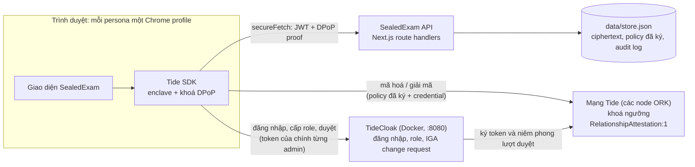
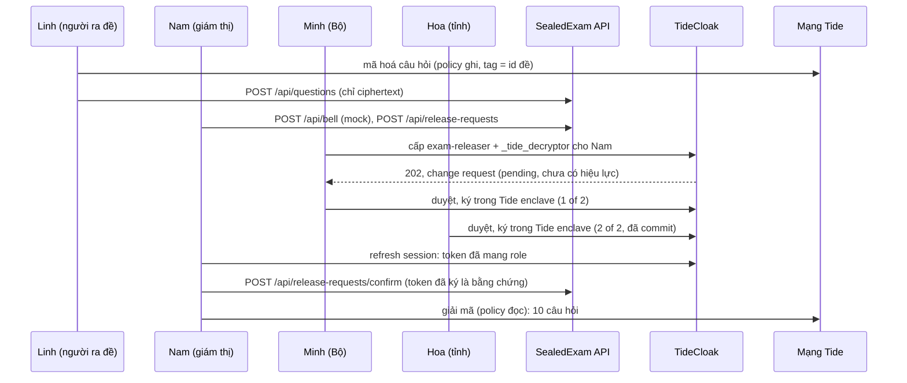

[](https://tide.org/tidecloak?utm_source=github&utm_medium=readme&utm_campaign=unlocked)

*English: [README.md](README.md)*

## Tổng quan dự án

SealedExam gửi đề thi quốc gia tới các điểm thi từ trước nhiều ngày, dưới dạng mã hoá, để không ai (kể cả Bộ hay nền tảng) tự mình mở được đề trước giờ thi.

Xây dựng với [TideCloak](https://tide.org/tidecloak?utm_source=github&utm_medium=readme&utm_campaign=unlocked).

### 1. Tầm nhìn và tính mới
Một chuỗi giữ đề số cho các kỳ thi quốc gia quan trọng. Đề đi sớm dưới dạng ciphertext; quyền mở đề chỉ xuất hiện vào giờ thi, khi các thành viên hội đồng độc lập cùng duyệt. Không quan chức, admin hay nhà cung cấp nào giữ quyền đó một mình.

### 2. Nút thắt niềm tin
Bảo mật đề thi dựa vào một chuỗi người được tin tưởng rất tốn kém: cách ly người ra đề, áp tải, niêm phong. Chuyển sang số chỉ dời master key sang tay admin cơ sở dữ liệu hoặc nhà cung cấp cloud, nên thi trên máy cấp quốc gia vẫn khó được tin. Không có master key thì đề có thể đi bằng đường số, đi sớm, ở quy mô quốc gia.

### 3. Giá trị và tác động
Khoảng một triệu thí sinh dự kỳ thi tốt nghiệp THPT Việt Nam mỗi năm. SealedExam giảm chi phí giữ đề vật lý, bảo vệ cán bộ trung thực khỏi bị nghi ngờ, và giúp thi trên máy trở nên đáng tin. Gian lận trong phòng thi vẫn cần kiểm soát tại phòng.

### 4. Vì sao TideCloak quan trọng
Câu hỏi được mã hoá ngay trong trình duyệt của người ra đề; mạng Tide chỉ giải mã cho role exam-releaser, nên server của app không bao giờ giải mã được. Người ra đề niêm phong được nhưng không mở lại được. Cấp role đó cần hai trong ba chữ ký của hội đồng trong enclave của TideCloak. Với login thường, ai nắm cơ sở dữ liệu là mở được đề.

### 5. Prototype và câu chuyện
Đã làm: dựng realm (sáu persona giả, hội đồng ba người), API chỉ lưu ciphertext với kiểm tra token, DPoP và role ở server (54 test pass), và các hàm trình duyệt để niêm phong, mở đề và duyệt theo quorum. Hãy chú ý: người vận hành chỉ thấy ciphertext; một quan chức tự cấp quyền thì dừng ở "1 of 2"; đủ hai lượt duyệt thì giám thị mở được đề. Tình trạng: dịch vụ licence của Tide lỗi trong lúc xây dựng, nên lần chạy thật vẫn đang chờ.

---

## Kiến trúc



**Tính chất quan trọng nhất:** không có mũi tên nào từ API sang mạng Tide. Server của app lưu và trả ciphertext, nhưng không có credential nào mà mạng chịu giải mã cho, và cũng không giữ khoá nào. Server tự kiểm token bằng JWKS nhúng sẵn của realm.

### Thành phần
| Thành phần | Ở đâu | Vai trò |
|---|---|---|
| Dựng realm | [`scripts/init-tidecloak.sh`](scripts/init-tidecloak.sh), [`scripts/realm.json.template`](scripts/realm.json.template) | Khởi động TideCloak, cấp licence cho realm, bật IGA, tạo role và sáu persona, đặt Minh, Hoa, Tuấn làm hội đồng (`tide-realm-admin`), xuất `data/tidecloak.json` |
| API | [`src/app/api/`](src/app/api) | Các route handler. Route nào cũng kiểm JWT, DPoP proof và role của người gọi ở server |
| Xác thực | [`src/lib/auth/`](src/lib/auth) | Kiểm token và DPoP (lấy từ template của Tide), kiểm role theo đúng không gian tên: role của app là realm role, hội đồng là `tide-realm-admin` chỉ trên `realm-management` |
| Lưu trữ | [`src/lib/store.ts`](src/lib/store.ts) | Một file JSON, để ai cũng có thể `cat data/store.json` và thấy trong đó không có plaintext hay khoá |
| Hàm Tide (trình duyệt) | [`src/lib/tide/`](src/lib/tide) | `sealQuestions` / `openQuestions` qua `RelationshipAttestation:1`; `requestReleaseGrant` và `approveChangeRequest` (duyệt hai pha qua enclave) |

### Role và hai policy của đề
| Persona (giả) | Trước giờ thi | Sau quorum |
|---|---|---|
| Linh, người ra đề | `exam-setter`, `_tide_encryptor` | |
| Minh (Bộ), Hoa (tỉnh), Tuấn (điểm thi) | `tide-realm-admin` (hội đồng) | |
| Nam, giám thị | `proctor` | + `exam-releaser`, `_tide_decryptor` |
| Quang, Admin IT | `it-operator` | |

Đề `paper-math-2026` có hai policy do mạng Tide ký (contract dựng sẵn `RelationshipAttestation:1`, mỗi item chỉ gắn đúng một tag là id của đề):
- **Ghi:** role `exam-setter`, `["_tide_encryptor"]`. Người ra đề niêm phong được nhưng không đọc được, kể cả câu của chính mình.
- **Đọc:** role `exam-releaser`, `["_tide_decryptor"]`. Trước giờ thi không ai có `_tide_decryptor`, nên ngay cả policy do một admin tự ký cũng không dùng được nếu không có lượt cấp role qua quorum.

### Luồng mở đề


Trường hợp quan chức tự cấp quyền đi đúng đường này: Minh tạo yêu cầu cấp cho chính mình rồi tự ký. TideCloak chỉ tính mỗi người duyệt một lần, nên yêu cầu dừng ở **1 of 2**, và mạng Tide vẫn từ chối giải mã.

### Ai làm được gì
| Tấn công | Login thường + phân quyền backend | SealedExam |
|---|---|---|
| Admin cơ sở dữ liệu hoặc cloud đọc ngân hàng đề | Đọc được mọi đề | Chỉ thấy ciphertext |
| Quan chức tự cấp quyền mở đề | Sửa một dòng là xong | Một change request pending ở 1 of 2; giải mã bị từ chối |
| Server của app bị xâm nhập | Lộ cả đề lẫn khoá | Server không có khoá nào để lấy |
| Đề bị chặn trên đường gửi | Tuỳ ai giữ khoá | Vô dụng nếu không có role mà mạng kiểm |

### Có sẵn, tự viết, giả lập
- **Có sẵn (TideCloak và Tide):** đăng nhập, role, mã hoá trong trình duyệt với giải mã theo role (`RelationshipAttestation:1`), IGA change request duyệt theo quorum trong enclave, mạng Tide thực thi.
- **Tự viết (repo này):** script dựng realm, API và các kiểm tra role, luồng yêu cầu mở đề, audit trail, màn hình vận hành.
- **Giả lập:** chuông giờ thi (một nút bấm, không phải time-lock), việc phân phối đề tới điểm thi, toàn bộ người, điểm thi và câu hỏi.

### Giới hạn
- Ngưỡng 2/3 đến từ quy tắc của TideCloak `max(1, floor(0.7 × số admin))` với ba admin hội đồng. Nó không phải cấu hình riêng cho một role, và áp dụng cho mọi thay đổi được quản trị trong realm.
- Cả quorum vẫn có thể thông đồng. Mọi lượt duyệt đều truy được người: TideCloak ghi lại từng người duyệt và thời điểm.
- Sau khi mở vào giờ thi, đề vẫn có thể bị chụp ảnh. Vẫn cần kiểm soát trong phòng thi.
- Server không tự đọc được change request của TideCloak (nó không giữ credential admin). Các lượt duyệt nó ghi là do trình duyệt của thành viên hội đồng chuyển lên, được gắn nhãn `client-reported`. Bằng chứng quyết định là token do TideCloak ký của chính giám thị.
- Server vẫn có thể xoá hoặc tráo ciphertext. Nó không đọc được đề, nhưng làm hỏng được tính toàn vẹn và tính sẵn sàng.
- Chưa kiểm trên realm thật: master admin của Keycloak có vượt được IGA không. [`scripts/check-master-admin-bypass.sh`](scripts/check-master-admin-bypass.sh) dùng để trả lời câu này.

---

## Cài đặt

### Yêu cầu
- macOS hoặc Linux (phát triển trên macOS arm64; chưa thử Windows)
- Node.js 20+ và npm
- Docker Desktop, đang chạy
- `curl`, `jq`
- Chrome hoặc Edge, mỗi persona một profile. Không dùng trình duyệt của VS Code: nó làm hỏng frame enclave của Tide.

### 1. Cài
```bash
npm install
cp .env.example .env
```
Điền `.env`:
- `KC_BOOTSTRAP_ADMIN_PASSWORD`: mật khẩu mạnh cho master admin của TideCloak chạy ở máy.
- `TIDE_LICENSE_EMAIL`: một email thật bạn đang dùng.
- `TIDE_TERMS_ACCEPTED=yes`, chỉ sau khi bạn đã đọc và đồng ý https://tide.org/legal.

`.env` và `data/` đã nằm trong `.gitignore`. Không bao giờ commit chúng.

### 2. Dựng TideCloak
```bash
npm run init
```
Script khởi động TideCloak ở `localhost:8080`, tạo realm `sealedexam` và sáu persona, rồi in một invite link cho mỗi persona (cũng lưu vào `data/invite-links.txt`). Mở từng link trong **đúng Chrome profile của persona đó** và tạo tài khoản Tide. Khi Chrome hỏi quyền truy cập thiết bị trong mạng nội bộ, chọn **Allow**, và cho phép popup cho `localhost:3000` và `localhost:8080`.

Khi cả sáu đã liên kết, script cấp role hội đồng và xuất `data/tidecloak.json`. Xem mấy dòng cuối: mọi thành viên hội đồng phải hiện `tide-realm-admin: true` và không còn change request nào pending.

### 3. Chạy
```bash
npm run dev          # http://localhost:3000
npm test             # 54 test: xác thực, DPoP, role, route, luồng mở đề
bash scripts/check-master-admin-bypass.sh
```

### 4. Kịch bản demo
1. **Minh, một lần trước ngày thi:** ký hai policy của đề.
2. **Linh:** niêm phong đề mẫu (mười câu Toán giả). Thử mở lại một câu: bị từ chối.
3. **Quang:** mở kho dữ liệu. Chỉ có ciphertext; thử mở đề thì bị từ chối.
4. **Minh:** tự cấp quyền mở đề. Change request dừng ở 1 of 2 và giải mã bị từ chối. Sau đó deny nó.
5. **Nam:** bấm chuông (mock) và xin mở đề.
6. **Minh, rồi Hoa:** duyệt lượt cấp quyền cho Nam trong popup của Tide. Tới 2 of 2 thì TideCloak commit.
7. **Nam:** refresh session (role mới có thể mất tới hai phút mới hiện), xác nhận lượt cấp và mở đề.
8. **Bất kỳ ai:** đọc audit trail.

### API
| Route | Ai được gọi |
|---|---|
| `POST /api/questions` | `exam-setter` |
| `GET /api/vault` | `it-operator` hoặc hội đồng |
| `GET /api/paper` | mọi người đã đăng nhập |
| `POST /api/policies` | hội đồng |
| `POST /api/bell` (mock) | `proctor` |
| `GET /api/release-requests` | mọi người đã đăng nhập |
| `POST /api/release-requests` | `proctor`, chỉ sau giờ thi |
| `PATCH /api/release-requests` | hội đồng (gắn một TideCloak change request) |
| `POST /api/release-requests/confirm` | `proctor` có token mang `exam-releaser` + `_tide_decryptor` |
| `GET /api/audit`, `POST /api/audit` | mọi người đã đăng nhập (sự kiện từ trình duyệt gắn nhãn `client-reported`) |

Gọi API bằng `secureFetch` của SDK. `fetch` thường với Bearer token sẽ bị từ chối, vì token đã gắn DPoP.

### Xử lý sự cố
| Triệu chứng | Cách xử lý |
|---|---|
| `setUpTideRealm failed (HTTP 500)`, `TIDE-IDPEXT-VENDOR-KEYGEN_FAILED` | Dịch vụ licence của Tide không phản hồi (`docker logs tidecloak \| grep Midgard`). Đợi rồi chạy lại `npm run init`. Lỗi này đã chặn lần chạy thật của nhóm ngày 22/10/2026. |
| Đăng nhập hoặc duyệt bị treo, không báo lỗi | Cho phép popup và quyền truy cập mạng nội bộ; dùng Chrome, không dùng trình duyệt của VS Code. |
| Role mới không hiện | Refresh session hoặc đăng nhập lại. |
| Session cũ bị lỗi | DevTools → Application → Storage → Clear site data, rồi đăng nhập lại. |

Toàn bộ người, điểm thi và câu hỏi trong repo này đều là giả.
